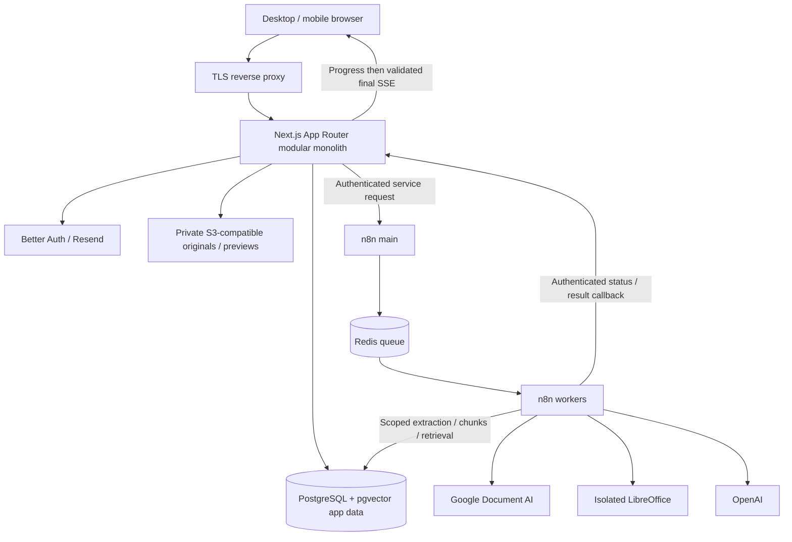

# Architecture implementation guide

The topology below describes the approved design. S01 establishes the App Router and its database module under `src/` plus local Compose infrastructure. [Technical PRD, sections 2–3](<../AI SOP Assistant — Technical Product Req.md>)

## Runtime boundaries

All browser application requests use authenticated Next.js APIs. A backend-authorized upload may send file bytes directly to private object storage using a short-lived presigned authorization; it does not expose n8n or cloud credentials.

| Owner | Responsibilities |
| --- | --- |
| Next.js | Identity, RBAC/current account state, invitations/users, document activation/deletion eligibility, authorized source access, conversation ownership/persistence, audit, browser SSE |
| n8n main/workers | Queue-based ingestion and interactive retrieval/ranking/generation/validation orchestration; authenticated progress/result callbacks |
| Application PostgreSQL | Authoritative documents/jobs/verification/chunks/conversations/sources/audit/evaluation; vector and keyword search |
| n8n PostgreSQL persistence | Separate database/schema and credentials for operational state; no shared unrestricted app role |
| Redis | n8n queue and, only if selected/proven, transient progress transport; never primary document/chat truth |
| Private S3/R2 | Immutable originals, derivatives, encrypted offsite backups; provider/region/recovery policy remain open |
| Conversion helper | Untrusted DOCX→PDF conversion with CPU/RAM/time/outbound-network restrictions |

## Confirmed decisions to preserve

| ADRs | Implementation direction |
| --- | --- |
| 01, 02, 06 | Next.js App Router + TypeScript modular monolith; Drizzle/PostgreSQL/pgvector; Better Auth |
| 03, 04, 21, 22 | Private S3-compatible originals; native extraction first; PDF.js and isolated LibreOffice previews; Google Enterprise Document OCR fallback |
| 05, 23 | OpenAI LLM/embeddings; GPT reranking of known source IDs. Verify the selected GPT-6 Luna label against actual enabled IDs before wiring calls; do not substitute silently |
| 07, 20 | Resend + React Email; Tailwind/shadcn, TanStack Table, React Hook Form/Zod, Lucide |
| 08, 09, 15 | Separate n8n Redis Queue Mode; one VPS with Compose; protected server secrets |
| 10, 11, 12 | Semantic + keyword retrieval, RRF, reranking; structure-aware chunks; deterministic checks plus independent judge |
| 13, 14, 16 | Structured Pino/offline evaluation; GitHub Actions with approval-gated deploy; encrypted six-hourly offsite database dumps |
| 17, 18, 19 | Assisted manual verification; persisted bounded context with follow-up rewrite; progress plus validated-final SSE |

Domain modules stay inside one codebase. S01 places routes in `src/app/` and database access in `src/server/db/`. Auth/users, documents, ingestion, verification, chat, and evaluation modules join this application in their respective sprints.

## Invariants and unresolved choices

Only manually verified ACTIVE source snapshots are evidence. Both query branches enforce eligibility before ranking; the backend rechecks sources before release/download. n8n cannot activate documents or change roles. Draft procedural text stays private until deterministic checks and an independent judge pass.

Queue Mode does not establish browser SSE by itself. The authenticated progress bridge needs an end-to-end spike; callbacks plus Redis pub/sub are an example, not a chosen contract. S3 versus R2, regions, exact models, OCR quotas, policy, limits, latency rubric, and real-data approval remain open in [PLANS.md](../PLANS.md).

See [database](database.md), [APIs](api-contracts.md), [RAG](rag-pipeline.md), [n8n](n8n-workflows.md), and [security](security.md) for task-specific guidance.
